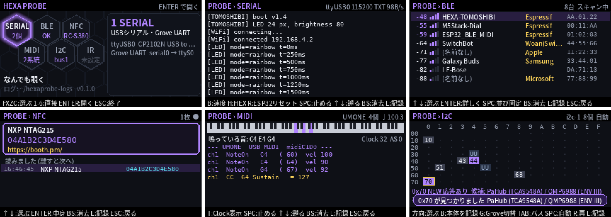

# HEXA PROBE v0.1

CardputerZero 用の「なんでも覗く」ﾂｰﾙ。ﾊﾆｶﾑのﾎｰﾑから 6 つの覗き窓を選ぶ。
画面の作りは HEXA CLIP / HEXA POWER と同じ流儀 (強調色は紫)。



## はじめる
```sh
cd ~/hexaprobe && sh install.sh          # sudo は付けない
sh install.sh --ir                       # 赤外線の受信も使うなら (GPIO13、要再起動)
sudo reboot                              # 初回だけ (ｱｲｺﾝと権限の反映)
```
ﾗﾝﾁｬｰの「HEXA PROBE」から起動。ｺﾏﾝﾄﾞなら `hexaprobe`、準備状況だけ見るなら `hexaprobe --probe`。

## 6 つの覗き窓
| ｷｰ | 名前 | 何が見えるか | 主なｷｰ |
|---|---|---|---|
| 1 | SERIAL | USB ｼﾘｱﾙ (ttyUSB/ttyACM) と Grove UART の受信 | B 速度 (115200〜921600, 9600〜, 74880, 31250) / H HEX表示 / R ESP32 ﾘｾｯﾄ (RTS) |
| 2 | BLE | 周りの BLE 機器。電波の強い順、名前・ﾒｰｶｰ・UUID | ENTER 詳しく / SPACE 並び固定 |
| 3 | NFC | RC-S380 でｶｰﾄﾞ/ﾀｸﾞ。種類・ID・NDEF・ﾀﾞﾝﾌﾟ | ENTER 中身 |
| 4 | MIDI | USB MIDI / Grove UART (Unit MIDI, 31250bps) のﾒｯｾｰｼﾞと鳴っている鍵盤 | T Clock も表示 |
| 5 | I2C | I2C ﾊﾞｽのｽｷｬﾝ (2秒ごと)。ｱﾄﾞﾚｽに部品名の候補 | B 本体を記録 / G Grove を UART↔I2C / TAB ﾊﾞｽ |
| 6 | IR | 赤外線ﾘﾓｺﾝ。NEC / 家製協 (AEHA) / SONY を解読、他は生ﾃﾞｰﾀ | ENTER 生ﾃﾞｰﾀ |

共通: **L = ﾛｸﾞ記録** (`~/hexaprobe-logs/<種類>-日時.log`、上のﾊﾞｰに ●REC)、SPACE 止める、↑↓ 遡る/選ぶ、BS 消去、ESC 戻る。
方向は F(↑) X(↓) Z(←) C(→)。ﾎｰﾑでは 1〜6 で直接開く。

## 使い方のｺﾂ
- **I2C で Unit を調べる**: 何も挿さずに B (本体を記録) → Unit を挿す → 増えたｱﾄﾞﾚｽが紫の NEW で光る。記録は `~/.config/hexaprobe/i2c-base-<bus>.json`
- **Grove は初期 UART**: I2C の Unit は G で I2C に切り替える (GPIO4)。I2C 画面を抜けると元に戻す。Grove の 5V は 設定 > ExtPort で ON
- **ESP32 の起動ﾛｸﾞ**: ESP32 のﾎﾞｰﾄﾞを挿して SERIAL → R でﾘｾｯﾄすると起動ﾛｸﾞが頭から見える。ESP8266 の起動直後は 74880bps
- **NFC** は HEXA SIGN と同じ `~/nfc` の nfcpy を使う (無ければ install.sh が入れる)。HEXA SIGN と同時には使えない

## 仕組み
- `hexaprobe.py` … 画面とｷｰ (一般ﾕｰｻﾞｰで動く)
- `hp_backends.py` … 取り込み部。どれも別ｽﾚｯﾄﾞでｲﾍﾞﾝﾄを積む
  - SERIAL: termios2 (BOTHER) で任意の速度。31250 / 74880 もそのまま
  - BLE: `bluetoothctl` を pty で動かして `[NEW]/[CHG]` を読む
  - NFC: `hp_nfc_helper.py` を nfcpy の python で別ﾌﾟﾛｾｽ実行 (JSON 1行ずつ)
  - MIDI: `/dev/snd/midiC*D*` (rawmidi) か `/dev/serial0` を自前でﾊﾟｰｽ (ﾗﾝﾆﾝｸﾞｽﾃｰﾀｽ/SysEx/ﾘｱﾙﾀｲﾑ)
  - I2C: `i2cdetect -y` (自動ﾓｰﾄﾞ) を定期実行。Grove 切替は `pinctrl set 4`
  - IR: `/dev/lirc0` の mode2 (µs のﾊﾟﾙｽ列) を読んで解読
- `hexaprobe --sim OUT` … PC 用。偽のﾃﾞｰﾀで全画面を PNG に保存

## 実機で確かめること
- BLE: `bluetoothctl` の出力形式 (RSSI の書き方) が読めるか、BT が OFF だと案内が出るか
- NFC: ~/nfc の nfcpy で読めるか (FeliCa のﾀﾞﾝﾌﾟは数秒かかることがある)
- I2C: `pinctrl` が sudo なしで動くか (gpio ｸﾞﾙｰﾌﾟ)。本体の I2C1 に何が並ぶか
- IR: `--ir` 後に /dev/lirc0 ができるか、家電ﾘﾓｺﾝ (家製協) が解読できるか
- MIDI: Unit MIDI の MIDI IN が Grove UART に届くか
- 1ｺｱで速いｼﾘｱﾙ (921600) を流した時に画面が追いつくか

## 困った時
- 画面が戻らない: `sudo pkill -CONT -f APPLaunch`
- ﾛｸﾞ: `~/.local/share/hexaprobe/app.log`
- 赤外線を元に戻す: `/boot/firmware/config.txt` の `dtoverlay=gpio-ir,gpio_pin=13` 行を消す (元は `.hexaprobe.bak`)
