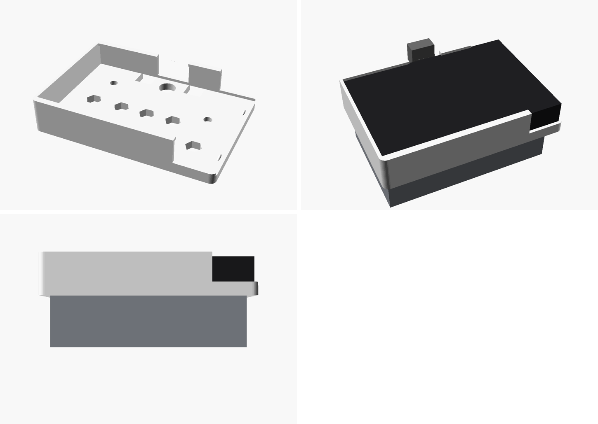

# 背面ﾊﾞｯﾃﾘｰﾄﾚｲ v0.1 (CIO SMARTCOBY SLIM 5000mAh 用)

CPZ の背面に M2 ﾈｼﾞ2本で付けるﾄﾚｲ。ﾓﾊﾞｲﾙﾊﾞｯﾃﾘｰ (60.8 × 88 × 12.11mm) を横から差し込み、
上の USB-C ｷｬｯﾌﾟ (`../cap/`) と短い C-C ｹｰﾌﾞﾙでつなぐ。ﾊﾟｽｽﾙｰ対応なので、ﾊﾞｯﾃﾘｰを充電しながら CPZ を動かせる。

- `hexa_cpz_battery_sled.stl` … 差し込み口 (ﾊﾞｯﾃﾘｰのﾎﾟｰﾄ側) が背面から見て**右**
- `hexa_cpz_battery_sled_left.stl` … 差し込み口が**左** (scad の `open_end`)
- 印刷: そのまま (背面に当たる面が下)、ｻﾎﾟｰﾄなし。約 26cm³
- 取り付け: 背面の M2 ｲﾝｻｰﾄ2つ (背面から見て (14,40) と (71,30)) に **M2×4** でﾄﾚｲを留める → ﾊﾞｯﾃﾘｰを差し込む。ﾈｼﾞ頭はﾊﾞｯﾃﾘｰの下に隠れる (ﾈｼﾞ下の床 1.5mm、長いﾈｼﾞは本体の中を傷めるので 4mm まで)
- ｶﾒﾗは隠れる (付けている間はｶﾒﾗを使わない前提)
- ﾊﾞｯﾃﾘｰの表面は長辺の縁 1.6mm だけで押さえるので、残量表示は見える。差し込み口側の長辺は上下とも 18mm 切ってあり、横のﾎﾞﾀﾝを押せる
- 抜け止め: 差し込み口の床に小さな山2つ (押し込むと乗り越える)
- 上の壁はｷｬｯﾌﾟの USB-C ﾌﾟﾗｸﾞの所だけ切ってある。ﾊﾞｯﾃﾘｰの上端は背面の上端から 1mm 上 (ﾌﾟﾗｸﾞに当たらない高さ)
- ｷｬｯﾌﾟの耳 (M2) の所は床を抜いてあるので、ｷｬｯﾌﾟとﾄﾚｲを両方付けられる
- 全体: 91.8 × 64.6mm (本体より左右 約4mm、下に 8mm 出る)、背面からの厚み 17.8mm

## 実物で合わせる所 (scad の先頭)
- `fit` … ﾊﾞｯﾃﾘｰとのすき間 (片側 0.3)。ｷﾂい→増やす / ｶﾞﾀつく→減らす
- `button_cut` … 横のﾎﾞﾀﾝの位置に合わせて、壁を切る長さ
- ﾊﾞｯﾃﾘｰの寸法は価格.com の仕様 (60.8 × 88 × 12.11) から。角の丸みは見ていない (ﾎﾟｹｯﾄは角あり)
- 背面のｲﾝｻｰﾄ位置・ｶﾒﾗ位置は公式外形図の読み取り。ﾈｼﾞ穴がずれたら `inserts` を直す
