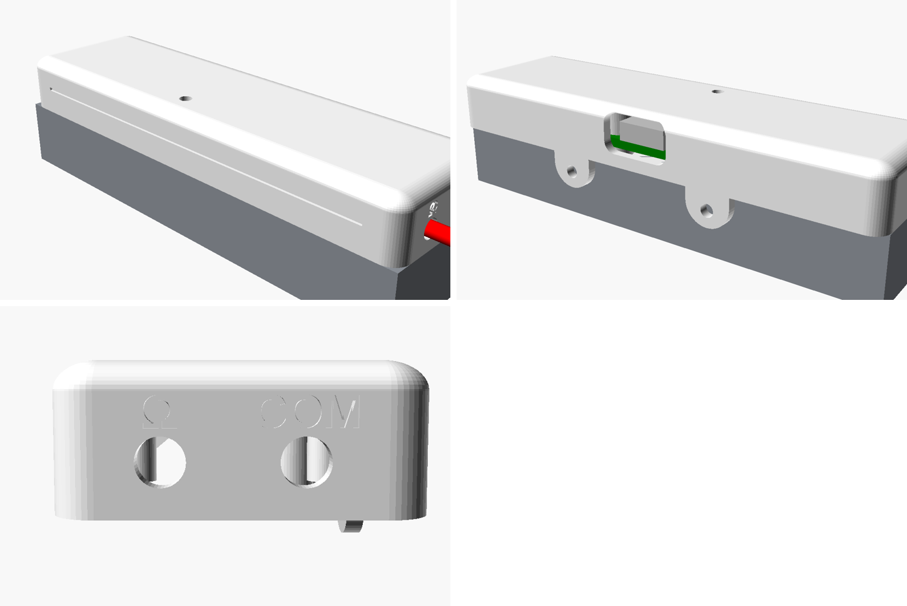

# ｷｬｯﾌﾟ (USB-C PWR 基板 v0.2 + TEST の配線) v0.1

Cap LoRa-1262 と同じ「上面まるごと」の形 (84 × 24 × 約10mm、背面の耳を除く)。
中に USB-C PWR 基板と、導通ﾁｪｯｸの配線 (G22 →1kΩ→ 赤 / GND → 黒) を収め、右端からﾃｽﾄ線2本を出す。

- 印刷: `hexa_cpz_probe_cap.stl` (天面を下、ｻﾎﾟｰﾄなし)。天面には刻印なし (印刷の底面がまっ平ら)
- 固定: v0.2 ｶﾊﾞーと同じ LEGO ﾋﾟﾝ2本 (基板を押さえる) ＋ 背面の耳 2つ (M2×4、Cap LoRa と同じ止め方)
- ﾃｽﾄ線: φ3.2 の穴2つ (AWG22〜20)。中の柱3本に S 字に通して抜け止め。先に 4mm ﾊﾞﾅﾅのﾒｽを付けると、市販のﾃｽﾀｰ棒やﾜﾆ口が挿さる
- 右端の刻印: 正面寄り = Ω (赤、G22)、背面寄り = COM (黒、GND)
- 1kΩ は G22 の線の途中に入れて熱収縮で包み、基板の右の空き (仕切りの奥) に置く

## 実測して合わせる所 (scad の先頭)
- `keepout` … 上面で塞ぎたくない所 (microSD など) を [x0, x1, y0, y1] で切り欠く。本体を正面から見て左端が x=0、背面が y=0
- `ear_z` … 背面の M2 穴の高さ (上面から下へ。仮に -3.1)。合わなければ `use_ears = false` で耳なし (LEGO ﾋﾟﾝだけでも止まる)
- `BD` … 本体の厚み (22.1)
