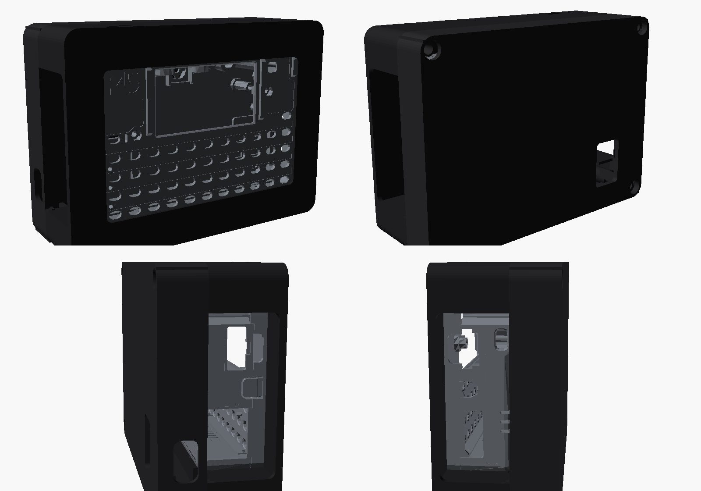

# CPZ ｹｰｽ v0.1.3 — 本体＋USB-C PWR 基板＋ﾓﾊﾞｲﾙﾊﾞｯﾃﾘｰを全部包む外装

CardputerZero 本体、上の USB-C PWR 基板、背面の CIO SMARTCOBY SLIM 5000mAh を1つの箱に入れる外装。正面から見ると、本体のまわりに 12mm の枠が上下左右同じ幅で付く。

## 部品 (2つ)
| ﾌｧｲﾙ | 中身 | 印刷 |
|---|---|---|
| `hexa_cpz_case_a_front.stl` | A 前ﾌﾚｰﾑ: 本体と上の基板が入る。正面の縁 (左右 0.8 / 上下 1.5mm) が本体を押さえる | 正面を下、ｻﾎﾟｰﾄなし |
| `hexa_cpz_case_b_back.stl` | B 後ろｹｰｽ: ﾓﾊﾞﾌﾞが入る。背面に残量窓 | 背面を下、ｻﾎﾟｰﾄなし |

外形 108 × 78 × 38.0mm (正面の縁から背面まで)。

## 要るもの
- M3 熱圧入ｲﾝｻｰﾄ 外径5 × 長さ4 ×4 (A の四隅、穴 φ4.4 × 深さ 5 → `ins_d` `ins_h`)
- M3×16 の六角穴付きﾎﾞﾀﾝﾎﾞﾙﾄ ×4 (背面の四隅、頭は 2.7mm 沈む。長さを変えたら `screw_len`)
- 短い C-C ｹｰﾌﾞﾙ (両端 L 字、10cm 前後)。基板側のﾌﾟﾗｸﾞは背面方向の長さ 12mm 以下

## 組み方
1. A の四隅にｲﾝｻｰﾄを入れる
2. 本体に USB-C PWR 基板を差し、基板の USB-C にｹｰﾌﾞﾙを差しておく
3. 本体を A の後ろから入れる (正面の縁に当たるまで)
4. ﾓﾊﾞﾌﾞを B に入れる (残量表示を背面側、USB-C の口を正面から見て左、ﾎﾞﾀﾝを下)
5. ｹｰﾌﾞﾙの反対側をﾓﾊﾞﾌﾞへ。余りは左端のすき間 (10mm) と、ﾓﾊﾞﾌﾞの上の通り道へ
6. B をかぶせて、背面の四隅を M3 で留める。ﾓﾊﾞﾌﾞが本体を前へ押してはさむ (本体へのねじ留めなし)

## 外から使える所
- 左右の側面の窓: 本体のﾎﾟｰﾄが全部見える (左 USB-A / USB-C / LAN、右 USB-C / Grove / 音声 / HDMI / ｽｲｯﾁ)
- 天面: IR の窓だけ (上の基板は隠れる。microSD はｹｰｽを開けて抜く)
- 底: ｽﾋﾟｰｶｰの穴、ﾓﾊﾞﾌﾞの電源ﾎﾞﾀﾝを押す板ﾊﾞﾈ
- 左の側面 (後ろ側): ﾓﾊﾞﾌﾞのもう1つの USB-C (充電・ﾊﾟｽｽﾙｰ)
- 背面: ﾓﾊﾞﾌﾞの残量窓

## ﾓﾊﾞﾌﾞの実測 (2026-11-28、v0.1.1 で反映)
- 88 × 61 × 12.2mm (`LB` `HB` `TB`)
- 外から挿す USB-C の中心: ﾎﾞﾀﾝ側の長辺から 13.8mm (`port_b`)
- 残量表示: 差し込み口側の端から 4〜17mm、ﾎﾞﾀﾝ側の長辺から 3〜21.8mm (`disp`)
- 電源ﾎﾞﾀﾝ: 奥の縁が端から 22mm → 中心 18.75 (`btn_x`)
- ｶﾞﾀがあれば背面の内側に薄いｽﾎﾟﾝｼﾞ

## 確認 (公式 STL)
- 本体・ﾓﾊﾞﾌﾞ・基板・ﾍｯﾀﾞｰと A/B は重ならない (本体の角の丸みだけ。箱で近似した時の誤差)
- 本体の背面は平ら (出っ張りなし)。ｶﾒﾗはﾓﾊﾞﾌﾞで隠れる
- 公式 STL は ../cap/body.stl に置いて `part="fit"` / `"show"` で描く (ﾘﾎﾟには入れない)
