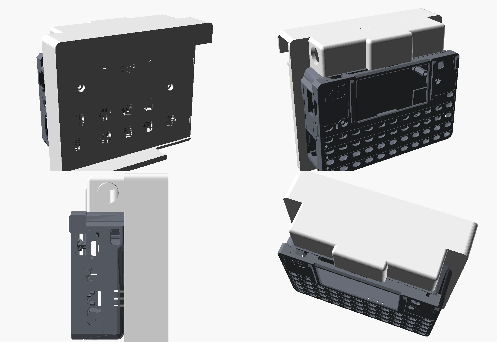

# ﾄﾞｯｸ v0.1 — USB-C PWR ｷｬｯﾌﾟ＋背面ﾊﾞｯﾃﾘｰﾄﾚｲの一体型

ｷｬｯﾌﾟ (`../cap`、v0.6) とﾊﾞｯﾃﾘｰﾄﾚｲ (`../battery-sled`) を1つの部品にした版。横から見て「T」の字で、上に基板のｷｬｯﾌﾟ、背面に CIO SMARTCOBY SLIM 5000mAh が付きます。

## ﾌｧｲﾙ
- `hexa_cpz_probe_dock.stl` … ﾊﾞｯﾃﾘｰの差し込み口が背面から見て**右**
- `hexa_cpz_probe_dock_left.stl` … 差し込み口が**左**
- `hexa_cpz_probe_dock_nojack.stl` … 右差し、ﾊﾞﾅﾅｼﾞｬｯｸの穴なし
- `hexa_cpz_probe_dock.scad` … ｷｬｯﾌﾟとﾄﾚｲの scad をそのまま使う (寸法はそれぞれの scad で合わせる)

## 付け方
1. USB-C PWR 基板を本体の 14P に差す
2. ﾄﾞｯｸを**真上から**下ろす (LEGO ﾋﾟﾝが穴へ、背面の板が背面に沿って下りる)
3. ﾊﾞｯﾃﾘｰを入れる前に、床の皿もみから **M2×4** で留める。穴は4つ: 上端の2つ (ｷｬｯﾌﾟ用の穴) ＋ 背面のｲﾝｻｰﾄ2つ。M2×6 以上は使わない
4. ﾊﾞｯﾃﾘｰを差し込み口から入れる
5. ｷｬｯﾌﾟの USB-C とﾊﾞｯﾃﾘｰを短い L字 C-C ｹｰﾌﾞﾙでつなぐ。ｹｰﾌﾞﾙはﾊﾞｯﾃﾘｰの上の「通り道」(高さ 11 × 奥行き 14mm、差し込み口側が開いている) に通す

## 印刷
- `part="print"` は差し込み口の**反対の端を下にして立てた**向き (高さ 92mm)。ﾎﾟｹｯﾄ・通り道・縁はすべて縦になるので、ﾄﾚｲ側にｻﾎﾟｰﾄは要らない
- **ｷｬｯﾌﾟの下の端 (ﾍﾞｯﾄﾞから約 10mm) だけ浮く**ので、そこにだけ「ﾍﾞｯﾄﾞからのｻﾎﾟｰﾄ」を付ける。ｷｬｯﾌﾟの中の柱と LEGO ﾋﾟﾝは横向きの丸棒になる (ｻﾎﾟｰﾄなしで刷れる太さ)
- 体積 約 37cm³

## 注意
- ﾍｯﾀﾞｰの抜き差しは、ﾄﾞｯｸごと上へ外す
- ｷｬｯﾌﾟ・ﾄﾚｲ単体の注意 (ﾎﾞﾀﾝの切り欠き、ｼﾞｬｯｸの長さなど) はそれぞれの README を見る
